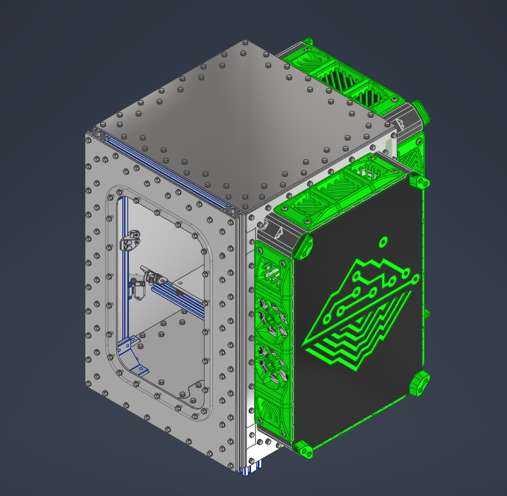
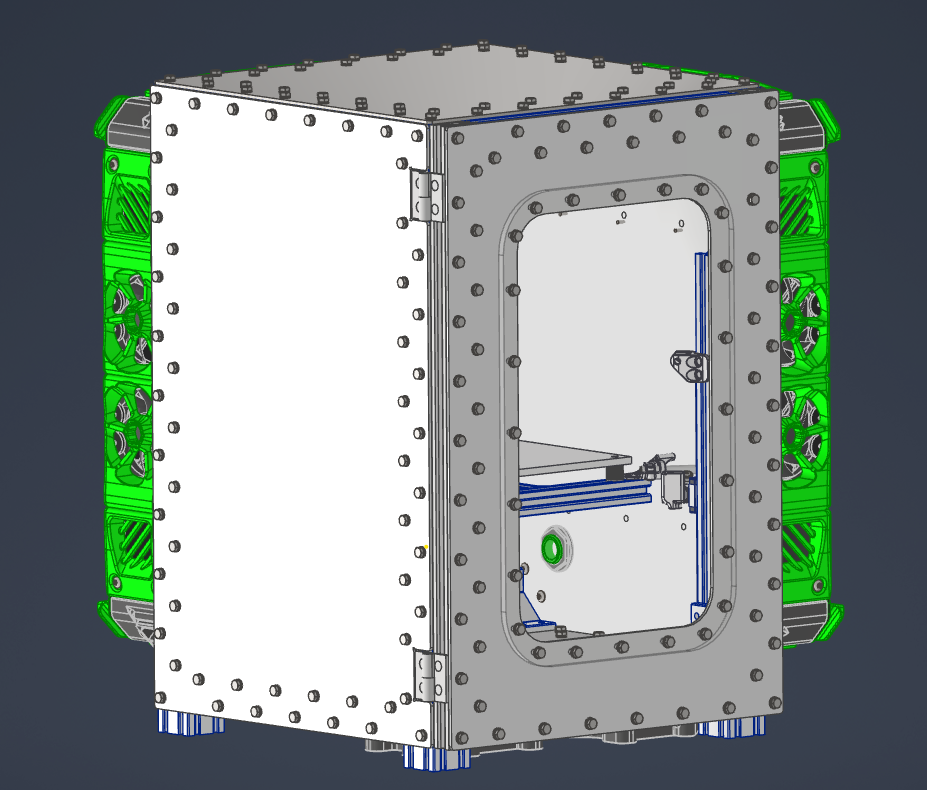

# K3-4040-frame

A variant of [Annex Engineering's K3](https://github.com/Annex-Engineering/Annex-Engineering_K3) built on a 4040 aluminium extrusion frame instead of the stock frame

## CAD files

A version of the frame for a regular extrusion K3 and a version for the Hula gantry are avalable.

| File | Description |
| --- | --- |
| [K3_4040.stp](CAD/K3_4040.stp) | K3 on the 4040 frame |
| [K3_Hula_4040_Frame.stp](CAD/K3_Hula_4040_Frame.stp) | K3 on the 4040 frame specifically for Hula |

## Hula

The Hula gantry is sold by Northprint3D:

- [Hula Halo for Annex Engineering K3 (complete set)](https://northprint3d.ca/product/hula-halo-for-annex-engineering-k3-complete-set/)

## License

See [LICENSE.md](LICENSE.md).
